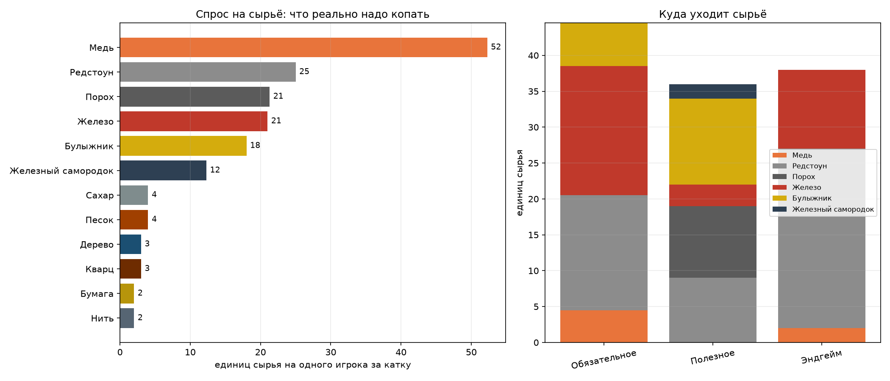
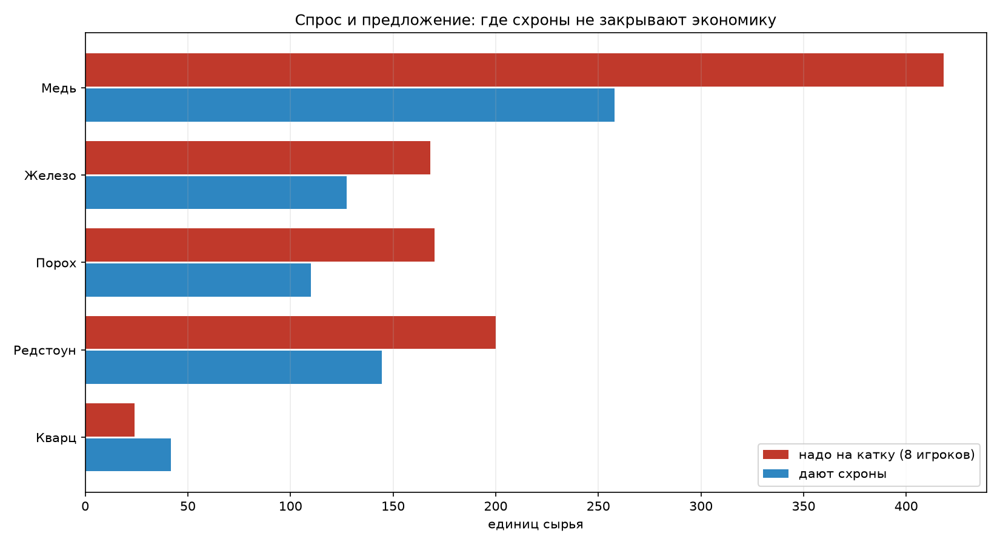

# Экономика лута Black Channel

Сгенерировано `docs/loot_stats.py`: скрипт читает рецепты всех модов из корня
репозитория (2 100+ рецептов), разворачивает их до сырья и сравнивает с тем,
что дают схроны. Пересобрать: `python3 docs/loot_stats.py`.

## Коротко

- Лимитируют игру **железо, порох и редстоун**, а не «редкие» вещи из пулов.
- Медь нужна в основном на патроны: один крафт 5.56 — это 15 меди и 3 пороха.
- Стволы TaCZ крафтятся на столе оружейника, но дорого: пистолет 16 железа, АК 38, AWP 200.
- Ствол без патронов бесполезен, поэтому к каждому выпавшему оружию добивается стак патронов.
- Ядерный заряд в игре собирается по-настоящему, но это проект на 4–8 часов, не на катку.

## Что из чего крафтится

| Предмет | Что нужно (в сумме) |
|---|---|
| Стол оружейника (патроны) | Железо 13, Дерево 3 |
| Крафт 9 мм (50 шт) | Медь 10, Порох 2 |
| Крафт 5.56 (45 шт) | Медь 15, Порох 3 |
| Крафт 12 калибра (12 шт) | Железный самородок 18, Медь 15, Порох 6 |
| Стойка-аплинк | Редстоун 13, Булыжник 6, Железо 5, Кварц 1 |
| Элемент питания | Медь 3, Редстоун 2 |
| IDS | Булыжник 12, Редстоун 6, Кварц 2, Железо 1 |
| Аптечка SBW | Нить 4, Ковёр 4, Золото (minecraft) 1 |
| C4 | Порох 10, Сахар 4, Песок 4, Часы 1 |
| ПНВ | Редстоун 9, Провод медный 8, Кварц 6, Чёрный краситель 6, leather 3 |
| Композитная броня | Композитная плита 8, Лист пластика 1 |
| Джетпак | Провод медный 16, Редстоун 16, Сталь (electrodynamics) 12, Кварц 12, Чёрный краситель 12 |

## Спрос на одного игрока за катку

Обязательное (стол оружейника, аплинк, три элемента питания), полезное (IDS,
трекер-логгер, две аптечки, две C4) и патроны — за вычетом того, что дали схроны.

| Сырьё | Сколько |
|---|---:|
| Медь | 52 |
| Редстоун | 25 |
| Порох | 21 |
| Железо | 21 |
| Булыжник | 18 |
| Железный самородок | 12 |
| Сахар | 4 |
| Песок | 4 |
| Дерево | 3 |
| Кварц | 3 |
| Бумага | 2 |
| Нить | 2 |

## Спрос и предложение на катку

Модель: 8 игроков, 21 схрон (карта 1000, 4 отряда), 4–6 вещей в схроне,
волны 55% / 30% / 15%, три аирдропа. Покрытие ниже 100% — остальное игрок
добывает сам, это и есть смысл копать.

| Сырьё | Надо | Дают схроны | Покрытие |
|---|---:|---:|---:|
| Медь | 418 | 258 | 62% |
| Железо | 168 | 128 | 76% |
| Порох | 170 | 110 | 64% |
| Редстоун | 200 | 145 | 72% |
| Кварц | 24 | 42 | 174% |

## Расходники за катку (в штуках)

| Что | Даёт лут | Надо на 8 игроков |
|---|---:|---:|
| Патроны из пулов | 1011 | 2752 |
| Патроны, добитые к стволам | 561 | — |
| Патроны всего | 1572 (57%) | 2752 |
| Стволы TaCZ | 23 | 16 |
| Навесное | 7 | 16 |
| Аптечки | 5 | 16 |

Остальные патроны (43%) игроки крафтят на столе оружейника из меди и пороха —
это и есть планомерная часть: схроны дают ствол и первый боезапас,
а не бесконечные патроны.

## Что и почему изменено

| Правка | Было | Стало | Причина |
|---|---|---|---|
| Патроны 9 мм | 24–48 | 48–96 | патроны — самый нужный расходник, их не хватало втрое |
| Патроны 5.56 | 20–40 | 40–80 | то же, это основной калибр средней волны |
| Патроны 7.62 | 20–40 | 40–80 | АК и СКС — самые частые стволы |
| Патроны .308 | 10–20 | 20–40 | поздняя волна и аирдроп |
| Медь | 8–16 @12 | 28–56 @22 | медь уходит на каждый крафт патронов |
| Железо | 4–8 @12 | 8–16 @18 + 12–24 @14 в средней | стол оружейника и аплинк — 18 железа на игрока |
| Порох | 4–8 @8 | 10–18 @22 + 12–24 @14 | порох нужен на каждый крафт патронов |
| Редстоун | 6–10 @8 | 8–14 @11 | аплинк, IDS, ПНВ, техника Electrodynamics |
| Волны схронов | 100% сразу | 55% / 30% / 15% | раньше все схроны ставились на старте |

Почему не «положить всего побольше»: если схроны закрывают 100% спроса, копать
становится незачем, и карта превращается в гонку по сундукам. Цель — 60–75%:
схроны снимают нужду, но медь, железо и порох всё ещё надо добывать.

## Что можно скрафтить за час

Оценка бюджета одного игрока за час: ~45 железа, ~110 меди, ~55 редстоуна,
~18 золота, ~4 алмаза, ~60 кварца (с заходом в Незер на 15 минут).
Это прикидка темпа шахты, а не замер: реальные числа зависят от карты и PvP.
Колонка «хватает сырья» — только про ресурсы: машинам ещё нужна энергосеть и время

| Цель | Что нужно | Хватает сырья |
|---|---|---|
| Стол оружейника | Железо 13, Дерево 3 | да |
| Крафт 9 мм (50 шт) | Медь 10, Порох 2 | да |
| Крафт 5.56 (45 шт) | Медь 15, Порох 3 | да |
| Стойка-аплинк | Редстоун 13, Булыжник 6, Железо 5, Кварц 1 | да |
| Дробилка | Медь 14, Провод медный 4.5, Редстоун 4, Чёрный краситель 3.4 | да |
| Генератор на угле | Булыжник 8, Сталь (electrodynamics) 3, Медь 2, Провод медный 0.5 | да |
| Базовая схема | Провод медный 4, Редстоун 4, Чёрный краситель 3, Сталь (electrodynamics) 0.43 | да |
| C4 | Порох 10, Сахар 4, Песок 4, Часы 1 | да |
| ПНВ | Редстоун 9, Провод медный 8, Кварц 6, Чёрный краситель 6 | да |
| Джетпак | Провод медный 16, Редстоун 16, Сталь (electrodynamics) 12, Кварц 12 | да |
| Хим. экстрактор | Провод медный 9, Редстоун 8, Чёрный краситель 6.8, Кварц 6 | да |
| Газ. центрифуга | Провод медный 16, Редстоун 16, Чёрный краситель 12, Кварц 12 | да |
| Ядерный бойлер | Провод медный 21, Редстоун 20, Чёрный краситель 16, Кварц 12 | да |
| Ядерный заряд Ballistix | Порох 343, Песок 213, Серная пыль 152, Гнилая плоть 64 | нет |

## Оружие TaCZ: сколько стоит скрафтить ствол

Стволы делаются на столе оружейника (tacz:gun_smith_table). Цена в рецепте —
это железо, золото, алмазы и лазурит, без навесного. Час шахты — примерно
45 железа, поэтому граница «своими руками за катку» проходит около 40–50 железа.

| Ствол | Железо | Золото | Алмазы | Лазурит | Прочее | За час |
|---|---:|---:|---:|---:|---|---|
| springfield1873 | 3 | 0 | 0 | 0 | — | да |
| db_short | 8 | 0 | 0 | 0 | — | да |
| db_long | 14 | 0 | 0 | 0 | — | да |
| deagle_golden | 16 | 32 | 1 | 0 | стержни ифрита 1 | да |
| glock_17 | 16 | 0 | 0 | 0 | — | да |
| m1911 | 16 | 0 | 0 | 0 | — | да |
| m9a4 | 16 | 0 | 0 | 0 | — | да |
| cz75 | 17 | 0 | 0 | 0 | — | да |
| b93r | 21 | 0 | 0 | 2 | — | да |
| m870 | 25 | 0 | 0 | 0 | — | да |
| kar98 | 28 | 4 | 0 | 12 | — | да |
| p320 | 28 | 4 | 0 | 2 | — | да |
| type_81 | 28 | 0 | 0 | 0 | — | да |
| m16a1 | 32 | 0 | 0 | 6 | — | да |
| rhino357 | 32 | 4 | 0 | 8 | — | да |
| uzi | 32 | 0 | 0 | 0 | — | да |
| hk_mk23 | 36 | 4 | 0 | 2 | — | да |
| hk_mp5a5 | 36 | 0 | 0 | 4 | — | да |
| m16a4 | 36 | 0 | 0 | 8 | — | да |
| ak47 | 38 | 0 | 0 | 6 | — | да |
| m4a1 | 38 | 0 | 0 | 6 | — | да |
| aug | 39 | 0 | 0 | 8 | аметист 1 | да |
| lonetrail | 40 | 4 | 0 | 20 | — | да |
| qbz_95 | 40 | 3 | 0 | 8 | — | да |
| sks_tactical | 40 | 0 | 0 | 8 | — | да |
| deagle | 42 | 6 | 2 | 0 | стержни ифрита 1 | да |
| m700 | 45 | 4 | 1 | 0 | — | да |
| scar_l | 48 | 6 | 0 | 0 | кварц 3 | да |
| timeless50 | 48 | 6 | 1 | 0 | — | да |
| m320 | 50 | 15 | 0 | 6 | — | нет |
| rpk | 56 | 8 | 0 | 0 | кварц 8 | нет |
| vector45 | 60 | 12 | 10 | 8 | — | нет |
| ump45 | 62 | 5 | 0 | 0 | кварц 3 | нет |
| fn_fal | 64 | 10 | 0 | 20 | — | нет |
| g36k | 64 | 16 | 0 | 0 | кварц 8 | нет |
| hk416d | 64 | 16 | 0 | 0 | кварц 8 | нет |
| m1014 | 64 | 12 | 1 | 8 | — | нет |
| qbz_191 | 64 | 8 | 0 | 16 | кварц 8 | нет |
| rpg7 | 70 | 8 | 0 | 4 | — | нет |
| hk_g3 | 72 | 9 | 0 | 0 | кварц 5 | нет |
| p90 | 72 | 8 | 2 | 0 | кварц 3 | нет |
| spr15hb | 72 | 8 | 2 | 0 | стержни ифрита 5 | нет |
| aa12 | 80 | 16 | 2 | 0 | стержни ифрита 4 | нет |
| mk14 | 84 | 20 | 4 | 0 | стержни ифрита 2 | нет |
| taurus500 | 85 | 65 | 8 | 0 | стержни ифрита 4 | нет |
| scar_h | 96 | 16 | 2 | 0 | стержни ифрита 4 | нет |
| m249 | 110 | 16 | 4 | 0 | стержни ифрита 2 | нет |
| spas_12 | 110 | 20 | 2 | 5 | — | нет |
| fn_evolys | 145 | 30 | 6 | 0 | стержни ифрита 5 | нет |
| ai_awp | 200 | 50 | 10 | 0 | стержни ифрита 5 | нет |
| m95 | 300 | 60 | 15 | 0 | незерит 3, стержни ифрита 5 | нет |
| m107 | 320 | 64 | 18 | 0 | незерит 3, стержни ифрита 5 | нет |
| minigun | 320 | 80 | 40 | 0 | незерит 10, стержни ифрита 10 | нет |

## Можно ли сделать ядерный заряд

Цепочка целиком, по рецептам из jar'ов:

1. Руда урана (Electrodynamics) → хим. экстрактор → жёлтый кек.
2. Ядерный бойлер → гексафторид урана.
3. Газ. центрифуга → U-235 и U-238 (передел без JSON-рецепта, внутри машины).
4. Стекло + U-235 + U-238 → топливный стержень HEUO2.
5. 4 термобарических заряда + 4 базовые схемы + стержень → ballistix:nuclear.

Машины, без которых шаг не пройти:

| Машина | Зачем | Что нужно |
|---|---|---|
| chemicalextractor | Хим. экстрактор: сырьё → жёлтый кек | Провод медный 9, Редстоун 8, Чёрный краситель 6.8, Кварц 6 |
| nuclearboiler | Ядерный бойлер: кек → гексафторид урана | Провод медный 21, Редстоун 20, Чёрный краситель 16, Кварц 12 |
| gascentrifuge | Газ. центрифуга: разделение U-235 и U-238 | Провод медный 16, Редстоун 16, Чёрный краситель 12, Кварц 12 |

Сам заряд в сырье:

| Ресурс | Сколько |
|---|---:|
| Порох | 343 |
| Песок | 213 |
| Серная пыль | 152 |
| Гнилая плоть | 64 |
| Ведро воды | 32 |
| Редстоун | 31 |
| Ведро лавы | 8 |
| Незеритовый скрап | 1 |

Вывод: **в принципе да**, всё крафтится, ничего не заблокировано. Практически —
нет: это 4–8 часов промышленной игры на команду (энергосеть, дробилка, три ядерные
машины, добыча урана, центрифугирование, плюс ~340 пороха в эквиваленте на сам заряд).
В часовую катку это не влезает даже у скиллового игрока, и это нормально:
ядерка — витрина мода, а не оружие катки.

## Коэффициент лута под размер катки

База в конфиге — эталон: 8 игроков и 14 схронов на карте 1000×1000.
Дальше применяется коэффициент K = (игроков / схронов) / (8/14) × (сторона/1000)^0.2,
вещи в сундуке и стаки домножаются на √K (чтобы сундук не распухал), K ограничен
сверху lootScaleMax (по умолчанию 3). Выключается ключом lootScaling = false.

| Катка | Схронов | K | Вещей в сундуке | Стак × |
|---|---:|---:|---:|---:|
| 8 игроков / 4 отряда / 1000 | 14 | 1.00 | 4.5 | 1.00 |
| 12 игроков / 3 отряда / 1000 | 10 | 2.10 | 6.5 | 1.45 |
| 16 игроков / 4 отряда / 1000 | 14 | 2.00 | 6.4 | 1.41 |
| 16 игроков / 8 отряда / 1000 | 28 | 1.00 | 4.5 | 1.00 |
| 24 игроков / 6 отряда / 1500 | 32 | 1.42 | 5.4 | 1.19 |
| 32 игроков / 8 отряда / 2500 | 56 | 1.20 | 4.9 | 1.10 |
| 8 игроков / 2 отряда / 1000 | 8 | 1.75 | 6.0 | 1.32 |
