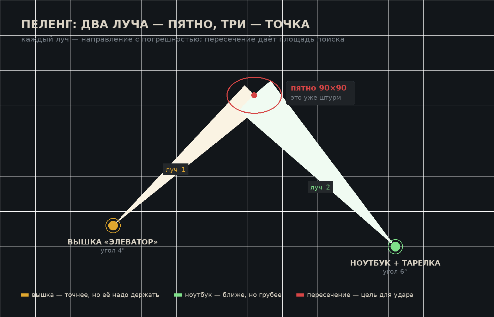

# 03. Радиослой

Сердце игры. Если из мода убрать всё, кроме этого файла, — «Чёрный канал» всё равно останется игрой, которой нет у других.

## Манифест

> **Информация — это оружие с отдачей.**
> Каждый выстрел в эфире слышно, каждая покупка пахнет, каждый шаг по сети оставляет след. Ты можешь узнать всё — но за это узнают и тебя.

## Четыре оси информации

Сейчас в моде есть первая ось — **точность**. Предлагаю добавить ещё три, потому что игра строится не на «знаю/не знаю», а на «насколько точно, насколько свежо и сколько это стоило».

| Ось | Вопрос игрока | Чем управляется |
|---|---|---|
| **Точность** | где именно? | луч / пятно / точка |
| **Свежесть** | когда это было? | след стареет, `memorySeconds`, `intelStaleSeconds` |
| **Источник** | откуда я это знаю? | свой прибор / вышка / куплено / перехвачено |
| **Цена** | кто ещё это знает? | шум от действия, слышимость |

Последняя ось — самая важная и самая недооценённая. Когда игрок покупает координаты, он должен чувствовать, что **продавец тоже что-то получил**: засветился, запомнил, продал ещё раз.

## След: модель данных

След — это не точка, а объект:

```
След {
  позывной: кто
  точка: где (x, z) или луч (x0,z0 → угол)
  сила: 0..100
  возраст: тики
  источник: TRACE / UAV / радар / стойка / ЭМИ / контракт
  достоверность: 0..1 (VPN врёт)
}
```

Правила отображения:

| Возраст | Как выглядит | Что можно сделать |
|---|---|---|
| 0–60 сек | яркая точка, точность по источнику | идти на штурм |
| 1–4 мин | пятно, пульсирует | выдвигаться в квадрат |
| 4–8 мин | сектор с вопросом | ставить вышку, слушать |
| >8 мин | бледная архивная метка | только как история |

Это уже почти есть в коде (`memorySeconds`, `intelStaleSeconds`, `TRACE_STALE`). Нужно не переписать, а **показать** игроку: сейчас следы стареют молча, а должны стареть на глазах.

## Пеленг: как это должно выглядеть и считаться

**Идея.** TRACE не даёт координату. TRACE даёт **направление** — и его надо пересечь с другим.

### Геометрия

- Точка приёма `A`, цель `T`, расстояние `d`, погрешность угла `α`.
- Боковая ошибка: `e = d · tan(α)`.
- При `α = 6°` и `d = 800` это `e = 84` блока. При `d = 1600` — уже `168`.

**Погрешность угла зависит от прибора и обстановки:**

| Прибор | α | Комментарий |
|---|---:|---|
| Телефон | 14° | грубо, но бесплатно |
| Ноутбук | 10° | базовая |
| Ноутбук + тарелка SIGINT | 6° | нужна энергия и место |
| Вышка связи | 4° | лучшее, что есть |
| Любой прибор в мёртвой зоне | — | не работает |
| Цель в авиарежиме | +40% к α | её почти не слышно |
| Цель под VPN | +25% к α и ложное смещение | врёт |



### Сколько лучей нужно

| Лучей | Что получаешь | Площадь пятна (при d≈1000) |
|---:|---|---|
| 1 | линия через полкарты | ~200×2000 |
| 2 | пересечение под углом 45–90° | 250×250 |
| 2 | пересечение под углом < 20° | 400×800 (почти бесполезно) |
| 3 | треугольник ошибок | 60×60 |

**Отсюда вся тактика:** второй луч добывается вторым прибором или второй точкой. Значит, отряду нужен либо второй ноутбук, либо вышка, либо союзник, который стоит в другом месте. Это ровно то, что должно двигать людьми по карте.

**Правило «не под прямым углом».** Если два приёмника стоят на одной линии с целью, лучи почти параллельны и пятно растягивается. Это делает позиционирование вышек настоящей задачей, а не «поставил где удобно».

### Что рисует телефон

- Один луч — тонкая линия, яркая у источника, тающая к концу.
- Два луча — линия + заштрихованный ромб пересечения.
- Три — ромб схлопывается в точку с крестиком.
- Всё это **без карты**: у нас нет миникарты, и это правильно. Телефон показывает схему: компас, лучи, сетка 500×500, твоя точка. Игрок сам переводит схему в мир.

## Вышки связи

Шесть штук, расставленных по кольцу 0.25–0.45 от центра (формулу расстановки надо привязать к существующей: `d = max(0.08N, min(0.45N, 0.60N/√K))`).

| Параметр | Значение | Почему |
|---|---:|---|
| Радиус пеленга | 400 | покрывает примерно сектор карты 1000 |
| Радиус карты сектора | 600 | видно движение, но не точные точки |
| Крипта | 2/мин | вышка должна окупаться за 20 минут |
| Время взлома | 20 сек (с эксплойтом), 40 сек (без) | успеть можно, но с риском |
| Шум взлома | 60, радиус 400 | вся округа знает |
| Восстановление после ЭМИ | 5 мин | ЭМИ — законный способ снять контроль |
| Антенна | светится цветом владельца | карта контроля видна глазами |

**Уязвимости и контр-игры.** Взлом, C4, ЭМИ, глушилка рядом (вышка глохнет, но не выключается), подмена (см. ниже). Ни одна вышка не должна быть «вечной».

**Почему шесть.** Четыре отряда × 1.5. Если вышек меньше — их делят сильные и слабым не достаётся. Если больше — все сидят на своих и не дерутся.

## Перехват трафика

Владелец вышки видит чужие действия в радиусе — но **анонимно**. Это делает контроль эфира ценным, не давая бесплатного чита.

| Событие | Что видно бесплатно | Что даёт расшифровка (крипта) |
|---|---|---|
| Чужой TRACE | факт + сектор | позывной |
| Чужая покупка | «кто-то купил» | что куплено |
| Удар SWAT | точка удара | заказчик |
| Взлом вышки | факт | кто взламывал |
| Аирдроп забрали | факт | кто забрал |
| Смерть игрока | позывной | кто убил |

**Цена расшифровки** — 8 крипты за строку, с задержкой 30 секунд (не мгновенно: иначе перехват превращается в чит).

## Обман

Самая недоигранная часть. Сейчас есть ложный маяк — и это отличная механика, которую надо масштабировать.

| Инструмент | Что делает | Цена | Риск |
|---|---|---|---|
| **Ложный маяк** (есть) | рисует чужой позывной в точке | есть в моде | заметят при проверке |
| **Эхо** | воспроизводит записанный чужой TRACE в другом месте | 30 | тратится навсегда |
| **Подмена вышки** | враг видит цвет своей, данные идут тебе | 60 | 3 минуты, потом сгорает |
| **Фальшивый контракт** | продать на рынке липовую карточку | 25 | репутация: рынок запоминает |
| **Призрак** | 30 секунд радар врага видит «игрока» | 20 | только один отряд |
| **Пустой удар** | вызвать SWAT по пустому месту, чтобы все пришли туда | 40 | деньги на ветер |

**Почему обман — это хорошо.** В игре про информацию ложь должна быть таким же законным ходом, как стрельба. Игрок, который соврал и выиграл время, должен чувствовать себя умным, а не читером.

## Мёртвые зоны

Три вида, все — про «здесь эфир не работает»:

1. **Глубокие пещеры.** Ниже −40 по Y телефон не ловит. Классика: в шахте ты в безопасности от пеленга, но и сам слеп.
2. **Глушилка.** Локальная зона 32 блока, ставится игроком, работает от энергии.
3. **Зона тишины в финале.** Ползёт от краёв к центру, снаружи — слепота и подсветка.

**Правило:** мёртвая зона никогда не убивает. Она отнимает информацию. Это дешевле в реализации и честнее к игроку, чем урон по таймеру.

## Подслушивание голоса (осторожно, но это бомба)

В сборке есть Simple Voice Chat, и у него есть серверный API: можно создать группу и **принудительно добавить в неё игрока**, а ещё можно проигрывать свой звук в статический канал конкретному игроку ([документация API](https://modrepo.de/minecraft/voicechat/api/examples)).

Отсюда две идеи разной степени безумия:

**Идея А — «жучок слушает» (осуществимо).** Жучок, приклеенный к игроку или к базе, добавляет владельца жучка в голосовую группу цели. Владелец слышит их переговоры в реальном времени. Радиус и время работы — из конфига, шум жучка постоянный.

**Идея Б — «голос канала» (осуществимо и безопасно).** Мод проигрывает в статический канал игроку короткие звуки: помехи при TRACE, щелчок реле при контакте, сводку диктора. Звук не из мира, а «в наушниках» — ровно то, что нужно для атмосферы.

**Мой совет:** делать Б сразу, а А — только как опцию, выключенную по умолчанию, с честным уведомлением в чате после катки («вас слушали 4 минуты»). Подслушивание живого голоса — это мощно, но это ещё и самый быстрый способ поссорить людей вне игры. Решение за тобой, вопрос вынесен в `09-voprosy.md`.

## Голос канала

Диегетический персонаж: усталый диспетчер, который ведёт вечер. Не помощник, не тренер — просто голос в эфире.

Где звучит:

| Момент | Реплика |
|---|---|
| Старт | «Канал открыт. Четыре отряда в эфире. Удачи, она вам понадобится.» |
| Первый шум | «Кто-то вышел в эфир. Уже интересно.» |
| Смена этапа | «Половина эфира позади. Дальше будет громче.» |
| Смерть отряда | «„Сосна“ больше не отвечает. Освободите частоту.» |
| Аирдроп | «Груз в квадрате 4-2. Кто первый, того и груз.» |
| Финал | «Канал закрывается. Осталось десять минут. Говорите быстро.» |
| Победа | «Эфир замолчал. Победили те, кто слушал.» |

Технически: текст в чат + звук через voicechat (если есть) + звук из блока радио (если нет). Плюс субтитры — обязательно, у половины игроков звук в наушниках выкручен на музыку.

## Матрица: что можно узнать и чем

| Что нужно знать | Чем добывается | Примерная цена | Живёт |
|---|---|---|---|
| В радиусе 100 блока есть кто-то | радар телефона | бесплатно | мгновенно |
| Направление на источник | TRACE | 2 крипты | 4 мин |
| Точка (2–3 луча) | 2–3 прибора или вышка | 4–10 | 2 мин |
| Позывной | DEANON | 4 | до смены SIM |
| Кто стрелял | перехват с вышки | 8 | 1 мин |
| Где база | маяк + 2 луча | 10–20 | 5 мин |
| Что у врага в руках | только глазами или добиванием | — | — |
| Кто лидер | сводка канала | бесплатно | 3 мин |

Последняя строка важна: **не всё можно купить**. То, что видно глазами и руками, должно оставаться ценным, иначе игра превратится в магазин.

## Что делать в понедельник (минимальный радиослой)

Если времени мало, порядок такой:

1. Шум как событие + подсветка «тебя слышно» (2 дня).
2. Пеленг-луч вместо точки + отрисовка на телефоне (2 дня).
3. Одна вышка на карту как тест (1 день).
4. Голос канала в текстовом виде (полдня, без звука).

Всё остальное — потом. Даже эти четыре вещи уже меняют игру до неузнаваемости.
