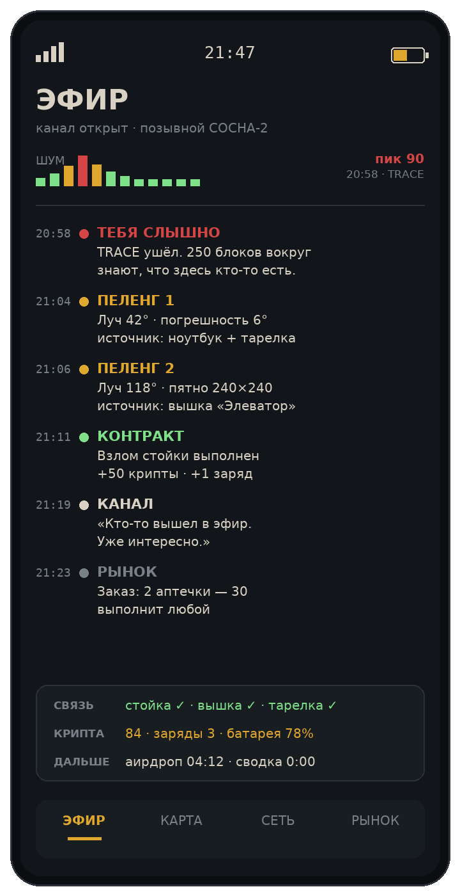

# 06. Интерфейс, звук, онбординг

## Четыре правила

1. **Мир важнее меню.** Пока открыт телефон, игрок должен видеть, что происходит вокруг.
2. **Один взгляд — одно решение.** Если на экране пять равных по важности цифр, игрок не примет ни одного решения.
3. **Звук — это интерфейс.** Половину информации игрок должен получать ушами, а не глазами.
4. **Новичок понимает за пятнадцать секунд.** Первый экран телефона — три кнопки, не двадцать.

## HUD: ровно 15 строк

Сайдбар Minecraft вмещает 15 строк — это жёсткий лимит клиента, больше не влезет ([подтверждение](https://github.com/NEZNAMY/TAB/wiki/Feature-guide:-Scoreboard)). Значит, каждая строка должна отрабатывать своё место. Предлагаю такую раскладку:

| # | Строка | Почему здесь |
|---:|---|---|
| 1 | `ЧЁРНЫЙ КАНАЛ` | заставка, не несёт информации |
| 2 | `ОХОТА · до финала 18:40` | этап + главный таймер |
| 3 | *(пустая)* | воздух |
| 4 | `▌СОСНА 42` | свой отряд, подсвечен |
| 5 | `▌КЕДР 31` | |
| 6 | `▌ОЛЬХА 28` | |
| 7 | `▌ВЯЗ 12` | |
| 8 | *(пустая)* | |
| 9 | `МАЯК ✓ КРОВАТЬ ✓ ВЫШЕК 1` | что у тебя из инфраструктуры |
| 10 | `КРИПТА 84 · ЗАРЯДЫ 3` | ресурсы |
| 11 | `ЭФИР ▁▂▅▂▁` | индикатор шума — сердце игры |
| 12 | *(пустая)* | |
| 13 | `ЖИВЫХ 11 · ВЫБЫЛО 5` | температура вечера |
| 14 | `СХРОНЫ 24 · ДРОП 04:12` | что скоро случится |

**Чего в сайдбаре быть не должно:** координат, названий предметов, лога событий, подсказок. Всё это — в чат, в телефон, в actionbar.

**Bossbar** — только этап: «СРЕДНИЙ ЭТАП · 12:40» с полоской. **Actionbar** — короткие события: «тебя слышно», «контакт 80 блоков», «SIM получена». **Тосты** — только награды и открытия.

## Телефон как ОС

Сейчас телефон — набор кнопок. Чтобы это стало «конфеткой», нужен минимальный, но цельный интерфейс.



### Структура экрана

```
┌─────────────────────────────┐
│ ▂▄▆ СИГНАЛ   21:47   🔋 78% │   ← статус-бар
├─────────────────────────────┤
│                             │
│        содержимое           │
│         вкладки             │
│                             │
├─────────────────────────────┤
│ ЭФИР  КАРТА  СЕТЬ  РЫНОК    │   ← 4 вкладки, не больше
└─────────────────────────────┘
```

**Четыре вкладки — предел.** Пятая превращает телефон в бухгалтерию.

| Вкладка | Что внутри |
|---|---|
| **ЭФИР** | лента: шумы, следы, перехваты, сводки канала |
| **КАРТА** | схема с лучами, свои метки, известные вышки |
| **СЕТЬ** | стойка, элементы питания, батарея, СИМ, VPN, авиарежим |
| **РЫНОК** | прилавок, заказы, интель |

### Состояния

Телефон должен **показывать, что с ним не так**:

| Состояние | Как выглядит | Что нельзя |
|---|---|---|
| Нет сети | серый экран, «НЕТ СИГНАЛА», статика | TRACE, рынок, чат |
| Мало батареи | жёлтая рамка, проценты мигают | тяжёлые действия |
| ЭМИ | чёрный экран с белой полосой, 28 сек | всё |
| Авиарежим | фиолетовая полоса, «ВНЕ ЭФИРА» | радар, но шум ×0.3 |
| Глушилка | рябь, часть символов заменена на `▓` | половина текста не читается |

Последнее — важно: **глушилка должна не блокировать, а портить**. Это страшнее и смешнее, чем просто «недоступно».

### Ощущение прибора

- Задержка 120–200 мс при переходе между вкладками (как у настоящего).
- Курсор и «нажатие» кнопки — с щелчком.
- Данные подгружаются не мгновенно: 0.5 сек «установка связи», потом цифры.
- Ошибки — с кодом: `ОШИБКА 404: абонент вне зоны`.

Это стоит недорого, а ощущается как устройство, а не как список.

## Ноутбук как рабочая станция

Ноутбук — не телефон с большим экраном, а другое рабочее место.

- **Слева** — список сигналов (таблица: позывной, сила, возраст, источник).
- **Справа** — схема с лучами и очередью задач.
- **Снизу** — строка команд: `TRACE`, `DEANON`, `UAV`, `SWAT`, `WIPE` с ценами.
- **Вверху** — состояние стойки: энергия, заряд, шум.

Ключевая идея: на ноутбуке видно **историю**, а не только текущий момент. Это место, где оператор ведёт дело, а не жмёт кнопки.

## Взлом: мини-игра на 6 секунд

Сейчас взлом — нажать кнопку. Предлагаю короткую настройку частоты:

- Ползунок ходит по шкале, есть «резонанс» — узкая зона.
- Чем ближе к резонансу, тем чище звук (слышно, а не видно).
- Попал в зону — держишь 2 секунды, готово.
- Промах — шум на 40 и подсветка тебя.

Итого 4–8 секунд напряжения, при этом руки заняты — риск реален. **Не QTE с молниями**, а «настройка приёмника».

## Цвет и типографика

| Роль | Цвет | Где |
|---|---|---|
| Фон | `#12161A` графит | подложка панелей |
| Текст | `#D9D2C4` костяной | основной |
| Акцент | `#E0A72E` янтарь | важные цифры, кнопки |
| Успех | `#7FE08A` CRT-зелёный | подтверждения |
| Тревога | `#D64545` | контакт, ЭМИ, смерть |

**Правила:**
- Никаких чистых белых и чёрных — только эти пять плюс оттенки серого.
- Никакого курсива и теней — интерфейс прибора, а не открытка.
- Минимум двух цветов на экран, иначе рябит.
- Для дальтоников: тревога дополнительно помечается символом `▲`, успех — `✓`.

## Звук: три слоя

| Слой | Что | Громкость | Приоритет |
|---|---|---|---|
| **Мир** | шаги, выстрелы, ветер, техника | 100% | нельзя глушить никогда |
| **Эфир** | статика, щелчки, голос канала, пеленг | 60% | приглушается в бою |
| **Интерфейс** | кнопки, переходы, уведомления | 40% | отключается в настройках |

**Читаемость важнее красоты.** Игрок должен различать на слух:

- **щелчок реле** — чужой TRACE в твоём радиусе;
- **восходящий свист** — твой пеленг ушёл;
- **глухой хлопок** — ЭМИ, всё глохнет;
- **низкий гул** — рядом глушилка;
- **двойной писк** — контракт выполнен;
- **тишина 2 секунды** — кто-то очень близко.

Последнее — самое сильное. Тишина в эфире должна пугать.

## Онбординг

**Проблема.** Новичок попадает на карту с телефоном и не понимает, зачем он тут. Гайд в телефоне есть, но его никто не читает.

**Решение — три задачи на первые 10 минут**, которые ведёт голос канала:

1. «Выйди в эфир» — нажать TRACE один раз. Награда: 5 крипты, объяснение.
2. «Найди второй луч» — подойти к вышке или напарнику, получить пересечение. Награда: 10 крипты.
3. «Соври» — поставить ложный маяк. Награда: 15 крипты.

Три задачи — пятнадцать минут — и человек понял игру.

**Полигон.** `/minigame practice` — маленькая арена, где есть манекены, вышка и стойка. Можно потренировать пеленг без риска. Админ может ставить новичкам.

**Карточка новичка.** Одноразовый набор: телефон, стойка, элемент питания, 20 крипты. Уже почти есть в стартовом наборе — надо добавить именно объяснение, а не предметы.

## Доступность и производительность

- **Шрифт** — минимум 12 pt, у всех панелей настраиваемый масштаб (клиентский конфиг).
- **Без мигания** — никаких вспышек чаще 3 Гц.
- **Синхронизация** — не чаще 4 раз в секунду, пачками; никаких пакетов каждый тик.
- **Кэш** — список сигналов обновляется по событию, а не каждый кадр.
- **Отключаемые эффекты** — рябь, статика, анимации: у людей со слабым ПК должно быть «сухо».

## Что делать в первую очередь

1. Сайдбар по схеме выше (полдня, только текст).
2. Индикатор эфира в сайдбаре (полдня).
3. Статус-бар телефона: сигнал, батарея, время (день).
4. Звуковые маркеры: щелчок, свист, хлопок (2 дня, нужны звуки).
5. Онбординг-задачи (2 дня).

Это самая дешёвая часть из всего пакета и самая заметная на стриме.
